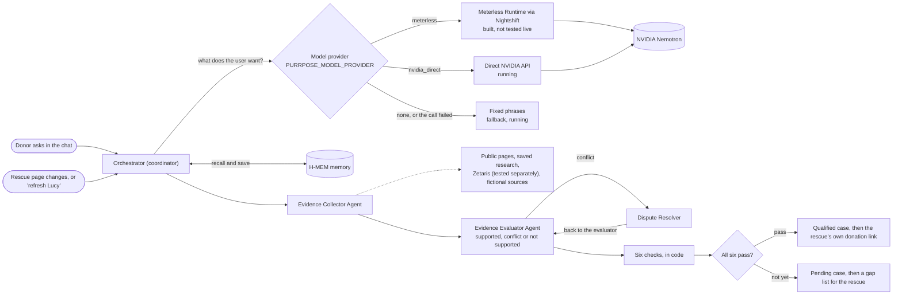

# Human Being Hackathon Workspace

Shared workspace for our Open Agent Hackathon 2026 ideas, mentor feedback and eventual project submission.

**For current development, read [START_HERE.md](START_HERE.md), then [HANDOFF.md](HANDOFF.md).** Purrpose is the current implementation direction. The sections below retain earlier proposal context; the handoff and full guidance describe current work. Application code now lives in [purrpose/](purrpose/README.md). Local H-MEM evidence is separate from the older synthetic wireframe.

## How Purrpose works

Run `python -m purrpose.server`, open `/home.html` for the chat with its **Review** and **Agent map** tabs, and `/dashboard.html` for every run since the server started (details in [purrpose/FRONTEND_INTEGRATION.md](purrpose/FRONTEND_INTEGRATION.md)).

The model only works out what the person wants. It never decides facts, amounts or qualification; code validates its answer and writes every reply. There is a path that doesn't go through Meterless Nightshift: the direct NVIDIA route runs today, and with no model configured, or if a call fails, the chat falls back to fixed phrases. The app never switches between providers on its own.

| Agent                    | What it does                                                                                                                                           | Roles in FULL_GUIDANCE §16                 |
| ------------------------ | ------------------------------------------------------------------------------------------------------------------------------------------------------ | ------------------------------------------- |
| Orchestrator             | Decides which agent works next, what to skip and when to stop, within the budget                                                                       | coordinator                                 |
| Evidence Collector Agent | Gathers relevant evidence from permitted public sources; the demo uses prepared sources                                                                | identity_risk, rescue_need, funding_channel |
| Evidence Evaluator Agent | Checks source credibility, conflicting information and missing evidence, and says clearly what remains unverified instead of forcing a positive result | evaluator                                   |
| Dispute Resolver         | Investigates one conflict the evaluator raised (for example, "pregnant" on 13 Oct versus "gave birth" on 14 Oct), then hands it back                   | dispute_resolver                            |

The agents are code roles inside one process (`purrpose/core.py`, `purrpose/real_review.py`); they are not separate models or model calls. After them, the six checks in plain code decide whether the whole case is qualified or pending. Lucy is a real case and stays pending, because her medical, funding and risk evidence is incomplete. Maple is fictional and exists only to show the full review.

For the interactive version, with notes on every node and three example runs, download [docs/architecture/how-it-fits.html](docs/architecture/how-it-fits.html) and open it in a browser. The editable diagram is [how-it-fits.drawio](docs/architecture/how-it-fits.drawio); regenerate it from the page's data with `node docs/architecture/build-drawio.cjs`.

## Purrpose first draft

[Open the first draft review folder](<first%20draft/README.md>): interactive hard-coded wireframe, plain-English guide, full implementation specification and review instructions. The wireframe runs locally without API keys or external services. This is a review draft, not a finished product.

Earlier proposals remain available for reference:

- [Purrpose](ideas/purrpose.md): help donors examine animal rescue requests and their supporting evidence.
- [Antenna Design Comparison](ideas/antenna-design-comparison.md): help RF engineers and students compare antenna designs from research papers.

## What we need to decide

1. Which user problem do we want to work on?
2. Can we access enough suitable evidence or papers?
3. What is the smallest convincing demo we can finish?
4. What does our mentor think about the scope and track fit?

## Where files belong

- `ideas/`: short proposals for discussion.
- `docs/`: decisions, mentor feedback, setup instructions and integration responsibilities.
- `purrpose/`: current application code, tests and reproducible local run instructions.
- Final approved presentation, demo instructions and submission links will live here too. Large recordings and datasets should be linked rather than committed.

This repository is the shared home for project files. Secrets stay in each teammate's local environment. Do not upload API keys, passwords, private donor information, or papers and images without permission to share them.

## Project status

The `ideas/` documents describe proposals. The working local application is in `purrpose/`; [HANDOFF.md](HANDOFF.md) records what actually runs, what was tested and what is still missing, including that Nightshift is not yet connected.

See [Working together](docs/working-together.md) and [Tool responsibilities](docs/tool-responsibilities.md).
